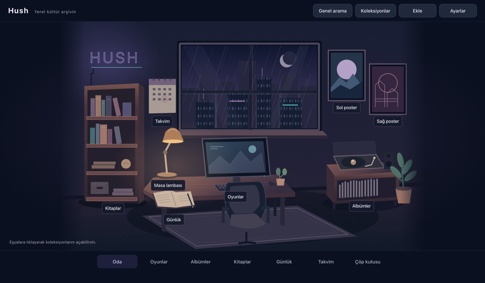
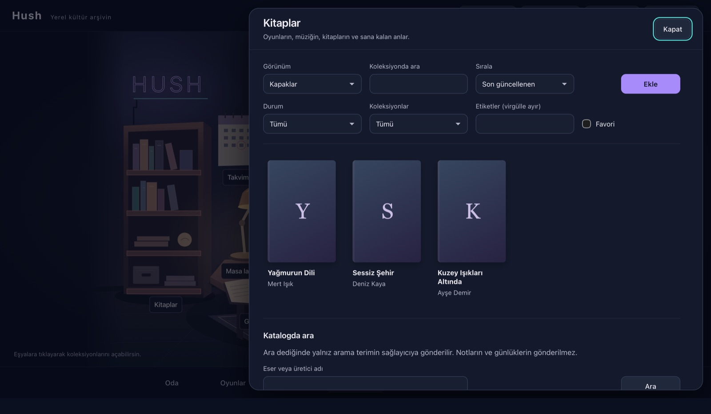
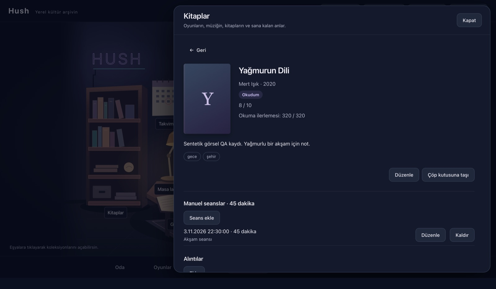
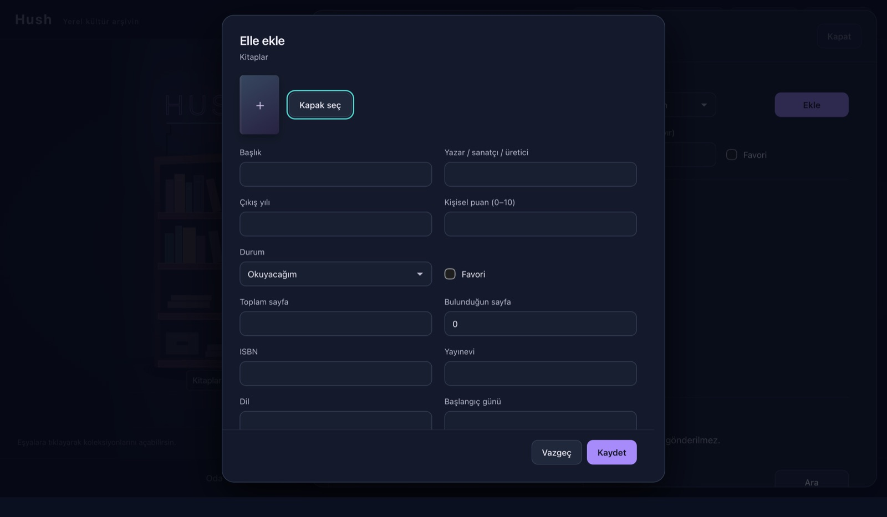

# Hush

Oyunlarını, albümlerini, kitaplarını ve günlüğünü yağmurlu bir gecede, cozy cyberpunk bir dijital odada sakladığın kişisel macOS uygulaması. Arayüz Türkçedir; veriler yalnız senin Mac'inde durur.



| Kitaplık | Eser detayı | Elle ekleme |
|---|---|---|
|  |  |  |

<sub>Ekran görüntüleri sentetik test verisiyle alınmıştır.</sub>

## Özellikler

- **Oda:** Çizim tarzında 2D oda. Kitaplık, oyun terminali, plak istasyonu, günlük defteri, takvim, iki poster ve masa lambası gerçek ekranları açar. Üç ışık düzeni (Cozy Night, Violet Rain, Quiet Dawn), neon parlaklığı, yağmur ve hareket ayarları vardır.
- **Koleksiyonlar:** Oyun, albüm ve kitap ekleme, düzenleme, çöp kutusu ve geri alma. Puan, not, etiket, favori ve karışık koleksiyonlar. Kitapta sayfa ilerlemesi ve alıntılar, oyunda seans ve ekran görüntüsü, albümde parça listesi.
- **Günlük ve takvim:** Ruh hâlli günlük kayıtları, otomatik taslak kurtarma, saat dilimine duyarlı ay görünümü ve özetler.
- **Arama:** Cmd+K ile yalnız yerel kayıtlarda Türkçe duyarlı arama.
- **Katalog (isteğe bağlı):** Open Library (kitap), MusicBrainz + Cover Art Archive (albüm), IGDB (oyun). Önce düzenlenebilir önizleme gelir, kapaklar yerel olarak saklanır ve çevrimdışı görünür.
- **Yedekleme:** Doğrulamalı `.hushbackup` dışa aktarma; özetli ve onaylı geri yükleme. Bozuk yedek mevcut veriyi değiştirmez.
- **Erişilebilirlik:** Bütün eşyalar gerçek düğmedir. Menü ve klavye eşdeğerleri (Cmd+1–9, Cmd+N, Cmd+S, Cmd+K, Cmd+,) vardır. Odak yönetimi ve hareket azaltma desteklenir.

## Gizlilik ve güvenlik

- Kişisel veriler `~/Library/Application Support/app.hush.desktop/` içinde SQLite ve yerel görseller olarak tutulur. Sunucu, hesap ya da bulut eşitleme yoktur.
- IGDB/Twitch kimlik bilgileri yalnız **macOS Keychain**'e yazılır; arayüze, veritabanına, yedeğe, loglara ya da bu depoya girmez. Depoda API anahtarı veya sır **yoktur**.
- Ağ isteklerini yalnız Rust katmanı, yalnız katalog araması için yapar. Notların ve günlüklerin hiçbir servise gönderilmez; arama kutusundaki terim dışında bilgi gitmez.
- Dış bağlantılar yalnız HTTPS olarak doğrulanıp sistem tarayıcısında açılır. Uygulama sıkı bir CSP ve dar Tauri izinleriyle çalışır.
- `.hushbackup` dosyaları **şifreli değildir**; kişisel içerik taşır, güvenli bir yerde sakla.

## Kurulum

Gereksinim: Apple Silicon Mac, macOS 14 veya sonrası.

1. `Hush-<sürüm>-aarch64.dmg` dosyasını aç, Hush'u Uygulamalar'a sürükle.
2. Paket ad-hoc imzalıdır ve **Apple notarization yapılmamıştır**. macOS açmayı engellerse, güvendiğin bu dosya için Sistem Ayarları → Gizlilik ve Güvenlik bölümündeki onayı kullan. Sistem korumalarını kapatma.

Ayrıntılı Türkçe kullanım: [docs/KURULUM-VE-KULLANIM.md](docs/KURULUM-VE-KULLANIM.md).

## Geliştirme

Araç zinciri ([docs/TOOLCHAIN.md](docs/TOOLCHAIN.md)): Node 24.18.0 (`.nvmrc`), Rust 1.97.1 (`rust-toolchain.toml`), Xcode Command Line Tools.
Yığın: Tauri 2, React, TypeScript (strict), Vite, Rust, SQLite.

```bash
npm ci
npm run dev
```

| Komut | İş |
|---|---|
| `npm run dev` | Tauri geliştirme penceresi |
| `npm run check` | TypeScript, ESLint, Vitest, production web build |
| `cargo test --locked --manifest-path src-tauri/Cargo.toml` | Rust testleri (loopback HTTP fixture'ları sandbox dışında çalışır) |
| `npm run test:native -- --regressions` | Gerçek Tauri/WebKit/SQLite native kabul paketleri (IPC mock yok) |
| `npm run test:native -- --visual` | Tüm ekranların 1440×900 ve 1100×720 görsel turu (`artifacts/ui/`) |
| `npm run test:native -- --performance` | 5.000 eser / 10.000 seans ölçümü |
| `npm run build:mac` | Apple Silicon `.app`, `.dmg`, ZIP ve SHA256 |
| `npm run verify:release` | Release paketinde test eklentisi, mock ve sır olmadığını denetler |

Native testler sentetik veriyle her seferinde yeni bir geçici dizinde çalışır ve gerçek kullanıcı verisine dokunmaz. Test sürücüsü `127.0.0.1:4445` portunu kullanır; `--manual` ile açılmış bir test penceresi varken diğer native testler bilerek çalışmaz.

```text
src/                 React arayüzü (app, features, components, infra/tauri istemcisi, i18n/tr.ts)
src-tauri/           Rust: commands, services, repositories, providers, storage, migrations
contracts/           SQL şeması, veri tipleri, oda yerleşimi ve tasarım değişkenleri
tests/native/        WebdriverIO native testleri; tests/fixtures yalnız sentetik veri
scripts/             native test, macOS paketleme ve release denetimi
docs/                ürün, mimari, plan, karar kaydı, test raporu
```

Mimari kurallar: UI → tipli istemci → Tauri komutları → Rust servisleri → SQLite/dosya sistemi. Bileşenlerde SQL veya doğrudan ağ isteği yoktur. Migration'lar yalnız eklemelidir.

## Belgeler

| Belge | İçerik |
|---|---|
| [01 Ürün ve kapsam](docs/01-URUN-VE-KAPSAM.md) | Kullanıcı akışları ve sürüm sınırları |
| [02 Mimari](docs/02-MIMARI.md) | Teknoloji, katmanlar, depolama, güvenlik |
| [03 Oda ve tasarım](docs/03-ODA-VE-TASARIM.md) | Sahne, hareket, erişilebilirlik ölçütleri |
| [04 Veri ve komutlar](docs/04-VERI-VE-KOMUTLAR.md) | Veri modeli ve yedekleme |
| [05 Katalog entegrasyonları](docs/05-KATALOG-ENTEGRASYONLARI.md) | API'ler, anahtar yönetimi, önbellek |
| [06 Uygulama planı](docs/06-UYGULAMA-PLANI.md) | Aşamalar ve kabul kapıları |
| [07 Test ve teslim](docs/07-GITHUB-TEST-VE-TESLIM.md) | Test katmanları, A01–A22 matrisi, paketleme |
| [08 Kararlar](docs/08-KARARLAR-VE-KAYNAKLAR.md) | Karar kaydı ve kaynaklar |
| [Test raporu](docs/TEST-REPORT.md) · [İlerleme](docs/PROGRESS.md) | Gerçek sonuçlar ve açık sınırlar |
| [Mimari paketi](docs/00-MIMARI-PAKETI.md) | Projenin başlangıçtaki tasarım paketi tanıtımı |

## Durum ve bilinen sınırlar

Sürüm 0.1.0. Otomatik birim, native kabul, performans ve görsel testler geçiyor. Fiziksel VoiceOver/klavye kabulü kullanıcı tarafından yapılmaktadır.

- Apple notarization yok; paket ad-hoc imzalı.
- MusicBrainz istekleri için kullanıcının kendi HTTPS iletişim adresini Ayarlar'a girmesi gerekir. IGDB isteğe bağlıdır; bağlantı yokken oyunlar elle eklenir.
- Dock menüsündeki "Çık" ve sistem kapanışı, açık formdaki kaydedilmemiş metni korumaz (Cmd+Q korur).

Üçüncü taraf lisansları: [THIRD-PARTY-NOTICES.md](THIRD-PARTY-NOTICES.md).
