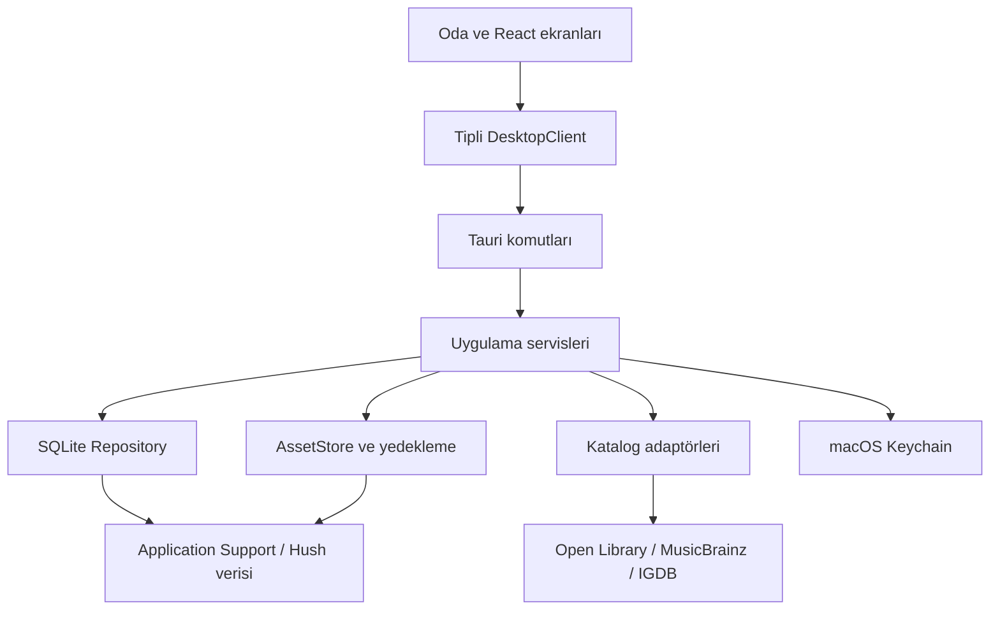

# 02 — Uygulanabilir mimari

## 1. Sabit teknoloji kararları

| Alan | Karar | Gerekçe |
|---|---|---|
| Masaüstü kabuğu | Tauri 2 | macOS penceresi, sistem WebView'i, yerel dosyalar ve Rust servisleri |
| Arayüz | React + TypeScript strict + Vite | Bileşen tabanlı ekranlar ve hızlı geliştirme |
| Stil | CSS Modules + CSS değişkenleri | Sahne katmanları ve ışıklar üzerinde açık kontrol; ikinci UI framework'ü yok |
| Erişilebilir temel | Radix Dialog, Tooltip, Select | Odak, Escape ve klavye davranışlarını yeniden icat etmemek |
| İkon | Lucide React | Menü/eylem ikonları; odadaki nesneler ikonla ikame edilmez |
| Formlar | React Hook Form + Zod | UI doğrulaması; Rust doğrulamasının yerine geçmez |
| Kalıcı veri sorguları | TanStack Query | Önbellek, yüklenme/hata durumları ve mutation sonrası yenileme |
| Geçici UI durumu | Zustand | Açık panel, panel geçmişi, seçim, arama filtreleri; eserlerin ikinci kopyası tutulmaz |
| Yerel servis | Rust + serde + thiserror + tokio | Tipli komutlar, dosya/network işleri |
| Veri tabanı | rusqlite (`bundled`, `backup`) + SQLite | Tek kullanıcı, işlemsel yerel veri ve güvenilir snapshot |
| Görsel işleme | Rust `image` | Boyut kontrolü, EXIF yönü düzeltme, metadata temizleme, küçük önizleme |
| Ağ | reqwest (TLS), URL parser | Katalog ve kapak indirme yalnız Rust'ta |
| Sır saklama | Rust `keyring`, macOS Keychain backend | IGDB secret/token'ın DB ve frontend'e sızmaması |
| Yedek | zip + SHA-256 + tempfile | Doğrulanabilir, taşınabilir tek dosya |
| Zaman/ID | UTC RFC3339, time/chrono; UUID v4 | Makine ve API bağımsız kimlikler |
| Test | Vitest + Testing Library; Rust testleri; WDIO embedded native testleri | UI, iş kuralları ve gerçek Tauri uygulamasını ayrı doğrulama |

Tauri dışındaki paketlerin major/patch sürümleri kasıtlı olarak uydurulmaz. İlk uygulama adımında uyumlu kararlı sürümleri çöz, `package-lock.json`, `Cargo.lock`, `.nvmrc`, `rust-toolchain.toml` ve `docs/TOOLCHAIN.md` içine kesin sürümleri yaz. CI aynı sürümleri kullanır. React preview/canary, Tauri beta veya kontrolsüz `latest` build kullanma.

## 2. Çalışma katmanları



- UI'da doğrudan `invoke()` kullanımı yalnız `src/infra/tauri/` içinde olur. Feature bileşeni `LibraryClient`, `JournalClient` gibi dar arayüzlere bağımlıdır.
- Rust `commands/` sadece DTO çözümleme, pencere kontrolü, servis çağrısı ve hata haritalaması yapar. SQL komut dosyalarına gömülmez.
- Servisler kuralları uygular: durum geçişi, tekrar kayıt kontrolü, item-kind doğrulaması, dosya referansları ve transaction sınırı.
- Repository'ler parametreli SQL kullanır. Kullanıcı sıralama/filtre değerleri sabit allowlist enum'undan SQL'e çevrilir; SQL parçaları istemciden alınmaz.
- Dosya ve ağ işlemleri render thread'i üzerinde bloklanmaz. SQLite bağlantısı `Arc<Mutex<Connection>>` ile korunur ve `spawn_blocking` içinde kullanılır. Mutex kilidi bir `await` boyunca tutulmaz.
- Ağ istekleri DB kilidi almadan yapılır. Kaydetme sırasında hazır veri ve dosyalar kısa bir yerel transaction'a girer.
- Tek pencere ve single-instance davranışı kullan. İkinci açılış mevcut pencereyi öne getirir; ikinci bir yazıcı süreç başlamaz.

## 3. Dizin yapısı

```text
hush/
├── AGENTS.md
├── README.md
├── CODEX_BASLANGIC.md
├── docs/                         # bu paket + PROGRESS, TOOLCHAIN, TEST-REPORT
├── contracts/                    # mimari sözleşmeler; runtime kopyaları ile uyum testi
├── src/
│   ├── app/                      # App, providers, AppShell, keyboard, panel history
│   ├── features/
│   │   ├── room/                 # scene, hotspots, lighting, config
│   │   ├── library/              # ortak grid, filtre, detay çerçevesi
│   │   ├── games/
│   │   ├── albums/
│   │   ├── books/
│   │   ├── journal/
│   │   ├── calendar/
│   │   ├── collections/
│   │   ├── catalog/
│   │   └── settings/
│   ├── components/ui/            # Button, Dialog, Field, EmptyState, ErrorState
│   ├── domain/                   # tipler, zod şemaları, saf yardımcılar
│   ├── infra/tauri/              # tipli client, invoke, error mapping
│   ├── i18n/tr.ts
│   ├── styles/                   # theme, globals, motion
│   └── assets/room/              # özgün katmanlar, props, varsayılan posterler
├── src-tauri/
│   ├── src/
│   │   ├── lib.rs
│   │   ├── commands/
│   │   ├── domain/
│   │   ├── services/
│   │   ├── repositories/
│   │   ├── providers/            # open_library, musicbrainz, igdb
│   │   └── storage/              # paths, migrations, assets, backup, recovery
│   ├── migrations/0001_initial.sql
│   ├── capabilities/main.json
│   ├── permissions/             # uygulama komutu izinleri
│   ├── tauri.conf.json
│   ├── Cargo.toml
│   └── Cargo.lock
├── tests/fixtures/               # yalnız sentetik veriler
├── tests/native/                 # gerçek IPC ve macOS testleri
├── .github/workflows/ci.yml
├── .github/workflows/release.yml
└── package.json
```

Başlangıç tek uygulama deposudur. Monorepo, mikroservis, GraphQL, ORM veya yerel HTTP sunucusu ekleme. Bir web önizleme adaptörü yalnız development/test için olabilir; üretimde `Tauri yoksa mock'a geç` davranışı yasaktır.

## 4. macOS pencere ve yaşam döngüsü

- Ürün adı `Hush`, identifier `app.hush.desktop`. İlk veri yazıldıktan sonra identifier'ı değiştirme; veri dizinini değiştirir.
- V1 destek politikası macOS **14+**; mevcut kullanıcı Mac'i Apple Silicon. Intel paket/uyumluluk garantisi v1 dışı.
- İlk boyut 1440×900 mantıksal piksel; kullanılabilir ekran alanına sığdır. Minimum içerik/pencere boyutu 1100×720; küçük ekranda ölçek ve scroll korunur.
- Normal macOS titlebar/traffic-light düğmeleri kullan. Pencereyi süssüz özel çerçeveye dönüştürme. Oda içerik alanında çizilir.
- Cmd+Q çıkar; Cmd+W pencereyi kapatır, Dock'tan yeniden açılır. Kirli form ve devam eden restore varsa kapanış öncesi uygun durum yönetimi gerekir.
- Pencere konumu/boyutu uygulama ayarından bağımsız window-state plugin'iyle saklanabilir. Ekran artık yoksa görünür alana geri taşı.
- Background/minimize durumunda dekoratif animasyonlar durur. Sistem “hareketi azalt” tercihine uy.
- Uygulama açılışında önce veri dizini/active pointer, recovery, migrations ve ayarlar hazırlanır; sonra oda. Hata oluşursa veriyi sıfırlamak yerine Türkçe kurtarma ekranı göster.

## 5. Kalıcı dosyalar

Yolu `app.path().app_data_dir()` ile çöz. macOS'ta identifier'a bağlı Application Support dizini olur; kullanıcı adını koda yazma.

```text
<app_data_dir>/
├── active.json                         # {formatVersion:1,generationId:"UUID"}
├── storage/<generationId>/
│   ├── library.sqlite3
│   └── assets/<assetId>/
│       ├── image.webp                 # yeniden kodlanmış ana görsel
│       └── thumb.webp                 # en uzun kenar 360 px
├── staging/                           # yarım import ve restore; açılışta temizlenebilir
├── recovery/                          # önceki generation hakkında küçük kayıt
└── logs/                              # dönen teknik günlükler; içerik/sır yok
<app_cache_dir>/catalog/                # silinebilir arama/thumbnail önbelleği
```

`active.json` tek aktif veri kümesini seçer; normal çalışma sırasında yeni generation yaratılmaz. Generation yapısının amacı restore sırasında tüm DB ve görselleri birlikte değiştirmektir. Bu, bulut eşitleme veya sürüm kontrolü sistemi değildir.

DB içinde görsel yolları göreli, ör. `assets/<id>/image.webp` saklanır. Mutlak kullanıcı yolu ve dış kaynak dosyanın asıl yolu kaydedilmez. Asset kayıtları taşınabilir olur. UI'a path yalnız AssetStore tarafından çözülerek verilir; UI patikayı değiştiren bir API alamaz.

## 6. Veri tabanı çalışma ilkeleri

- Her bağlantıda `foreign_keys=ON`, `journal_mode=WAL`, `busy_timeout=5000`, `synchronous=FULL`.
- Migration runner `PRAGMA user_version` kullanır; her migration transaction içindedir. Mevcut sürüm uygulamanın desteklediğinden yeniyse yazma yapılmaz.
- Gelecekteki migration'dan önce SQLite backup API ile snapshot alınır. İlk boş DB için gerekmez.
- Tarihler UTC RFC3339 milisaniye + `Z`; salt takvim günleri `YYYY-MM-DD`. UI `tr-TR`, sistem saat dilimi kullanır. Günlükte seçilen gün saat dilimi değişince kaydırılmaz.
- Kaydı güncellemede `revision` iyimser eşzamanlılık kontrolü kullanılır. Eski form yeni bilgiyi ezemez; `CONFLICT` sonrası form korunarak yenileme seçeneği sunulur.
- Kalıcı kayıtlar için UUID istemci işlem başlamadan üretir; tekrar denemede aynı ID kullanılır. Aynı create'in tekrarında içerik aynıysa mevcut kayıt döndürülür; farklıysa conflict.

## 7. Görseller

Kullanıcı import'u native dosya seçiciyle başlar; Rust seçilen dosyayı kendisi açar. Frontend `import_any_path` veya shell komutu çağıramaz. PNG/JPEG/WebP; en fazla 20 MiB kaynak ve 25 megapiksel decode limiti. SVG/GIF/HEIC için v1 açık “Desteklenmeyen biçim” mesajı ve dönüştürme önerisi.

EXIF yönünü düzelt, renk dönüşümünü desteklenen sRGB akışına al, metadata'yı kaldır, en uzun kenarı kapakta 1600, ekran görüntüsünde 2560'a sınırla. Ana görüntü ve 360 px önizleme üret. Decode işi blocking worker'da yapılır. Orijinal dosya değiştirilmez. Başarısız işte geçici dosyalar temizlenir.

Önce staging'e yaz/sync et, son asset dizinine atomik taşı, ardından DB asset satırını oluştur. Item save bunu referanslar. DB hatasında referanssız dosya kalırsa bir sonraki orphan temizliği kaldırır. Dosya yazmadan DB'de başarılı referans yaratılmaz.

Asset kullanımı: kapaklar, screenshot'lar, posterler. Referans sayısını elde güncel tutmak yerine bu tablolardan sorgula. Çöp kutusundaki kayıtların referansı geçerlidir. Yalnız 24 saatten eski, referanssız asset'ler bakımda temizlenir; bu sırada açık import/düzenleme draft lease'leri korunur. Silinmiş öğenin kapak dosyasını anında silme.

Tauri asset protocol kapsamı yalnız `$APPDATA/storage/*/assets/**/*`; DB/log/Keychain dosyaları dahil değildir. `convertFileSrc` yalnız bu çözülmüş path için kullanılır. Üretim CSP'de asset kaynağı ve yerel paket kaynakları tanımlanır; keyfi internet görselleri WebView tarafından çekilmez. [Tauri asset scope](https://v2.tauri.app/security/asset-protocol/)

## 8. Güvenlik ve hata ilkeleri

- Yalnız `main` yerel penceresi tanımlı komutları çağırır. Açık filesystem/shell/HTTP plugin yetkisi verilmez. Custom commands için de açık permission/allowlist tanımla; yalnız plugin capability'lerinin yeterli olduğunu varsayma. [Tauri capabilities](https://v2.tauri.app/security/capabilities/)
- UI uzak sayfaya navigate etmez. Dış bağlantı Rust'ta URL parser ile doğrulanır; yalnız HTTPS ve kullanıcı tıklamasıyla sistem tarayıcısında açılır. `file:`, `javascript:`, özel shell şemaları kabul edilmez.
- Katalog metinleri düz metin olarak gösterilir. HTML çalıştırılmaz. `dangerouslySetInnerHTML` yok.
- API anahtarı Keychain'e yazılır; sonra giriş formundan temizlenir. Okuma komutu secret döndürmez; sadece bağlı/bağlı değil sonucu verir.
- Günlüklere kişisel not, arama metni, başlık, tam filesystem path, token veya HTTP Authorization header yazılmaz. Hata kodu, işlem adı, süre ve korelasyon ID yeterlidir.
- Her uzun işlemin yüklenme, iptal veya güvenli kapanış davranışı vardır. Restore commit başladıktan sonra iptal gösterilmez; daha önce iptal edilebilir.

## 9. Performans bütçeleri — hedef, ölçülmüş sonuç değil

Apple Silicon'da release build ve 5.000 eser/10.000 seans sentetik veriyle: soğuk açılış hedefi ≤3 sn, yerel arama p95 ≤200 ms, panel açılış hissi ≤150 ms; animasyonda hedef 60 fps. Gizli/minimize sahnede animasyon işi sıfıra yaklaşmalı. İşlem CPU/RSS ölçümleri TEST-REPORT'a cihaz ve koşulla yazılır; platformdan bağımsız sabit pil tüketimi iddiası yapılmaz.

Sayfalama 60 kayıt; bir seferde binlerce kapak decode etme. CSS transform/opacity animasyonu kullan; geniş alanlı blur/bloom, yüzlerce DOM yağmur damlası ve sürekli React state güncellemesi yapma. UI thread'inde görüntü yeniden boyutlandırma yok.
